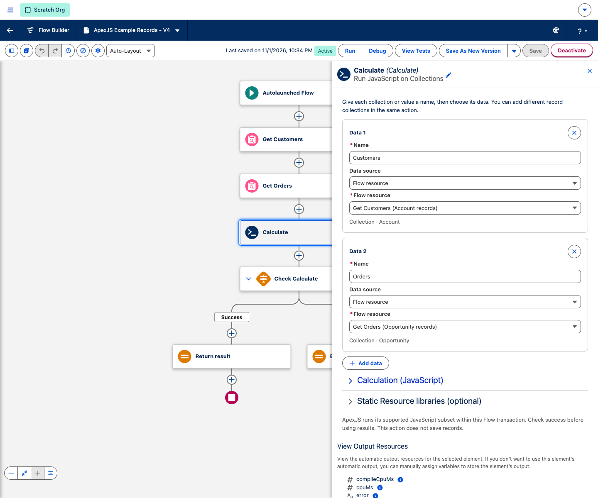

# ApexJS admin guide

## What you can build

Use ApexJS when a short calculation or collection transformation would otherwise require many Flow loops, assignments, or helper actions. Examples include summing Opportunities by Account, applying rules across several collections, removing duplicate values, and returning several kinds of results from one calculation.

You configure the data using form fields. Only the calculation itself is JavaScript. Prepare Portwood Data can also prepare collections without any JavaScript.



## Installation and permissions

1. Follow the [unmanaged package installation guide](installation.md), choose **Install for Admins Only**, and validate in a sandbox first. Source deployment using the README commands is also available. This release uses Metadata API 68.0, including structured action inputs and inline collection mappings.
2. Assign **ApexJS Author** to Flow designers. It grants the Apex class access used by the actions and the design-time library picker. It does **not** grant Manage Flow or permission to upload Static Resources; those Salesforce permissions must already be assigned separately.
3. Assign **ApexJS User** to users who need the runtime classes through their Flow execution context. Authors already have the runtime class access through ApexJS Author. Normal Flow execution permissions still apply.
4. In Flow Builder, add an Action and search for **ApexJS** or the action name. If an action is missing, confirm the deployment and class access, then reload Flow Builder.
5. Portwood is required only to generate a document after preparation. ApexJS itself does not install Portwood or modify its managed package.

The package adds Apex classes, property-editor components, two permission sets, and a small example library. It adds no custom objects, triggers, tabs, scheduled jobs, or record automation.

## First Flow: sum Opportunity amounts

Create an autolaunched Flow for this walkthrough, or use a suitable existing Flow.

1. Add **Get Records** for Opportunity. Store all matching records as a collection and include the fields the calculation needs, such as Id, Name, AccountId, and Amount. Use a filter appropriate to your sandbox data.
2. Add **Run JavaScript on Collections**. Give the element an API name such as `Calculate`.
3. Click **Add data**. Enter **Orders** in Name, leave Data source as **Flow resource**, and select your Opportunity collection. The editor detects that it is a record collection.
4. Open **Calculation (JavaScript)** and enter the example below.
5. Add a **Decision** after the action. Continue only when `Calculate.success` is true. On false, handle `Calculate.error` and end or take an error path. Also connect the action's fault path for Salesforce-level failures.
6. Add **Read JavaScript Result**. Select **Calculate → resultJson**, enter `Summary.Total` as Result path, and choose **Number** as Return to Flow as.
7. Check the reader's `success`, then use its **numberValue** output in an Assignment, Decision, screen, or later action.
8. Debug with zero, one, and several matching records before activation.

```javascript
var total = input.Orders.reduce(function (sum, order) {
  return sum + (order.Amount || 0);
}, 0);
return { Summary: { Total: total, Count: input.Orders.length } };
```

Names and returned property names are case-sensitive. `Orders` and `orders` are different. The function body receives `input`; do not wrap the entire calculation in another function declaration. Use `return` to provide a result. A calculation with no return value produces a null JSON result.

## Add multiple collections and values

Click **Add data** for each entry in the same action. No binding or Transform elements are required for this setup.

| Name      | Selected data                    | Calculation access |
| --------- | -------------------------------- | ------------------ |
| Customers | Account collection               | `input.Customers`  |
| Orders    | Opportunity collection           | `input.Orders`     |
| Amounts   | Number collection                | `input.Amounts`    |
| Labels    | Text collection                  | `input.Labels`     |
| Flags     | Boolean collection               | `input.Flags`      |
| DueDates  | Date collection                  | `input.DueDates`   |
| Times     | Date/Time collection             | `input.Times`      |
| Threshold | Number resource or entered value | `input.Threshold`  |

Accounts and Opportunities are separate choices and retain their supplied fields. Repeated types are supported, such as two independent number collections or several date collections. There is no fixed collection-slot count; combined data and execution budgets still apply.

For a literal, select **Enter a value**, choose its type, and use the normal text, number, checkbox, date, or date/time control. Zero and false are valid values. A collection with no values arrives as an empty array. Null collection elements retain their positions. An unset scalar arrives as null.

Names must start with a letter and use letters, numbers, or underscores. Use a different name for each entry. `constructor` and `prototype` are reserved. You do not type JSON or Flow reference syntax into these data-entry controls.

The picker includes supported variables, Get Records resources, constants, formulas, transforms, and typed outputs from Read JavaScript Result. If data from another component is not listed, assign it to a supported Flow variable and select that variable. Arbitrary custom Apex-defined objects are not native entries in this form; use the Apex JSON API for such data after converting it to ordinary JSON.

## Choose where the calculation comes from

You can write the function body in the calculation area, or select **Use a Flow text resource for the calculation** and choose an appropriate text resource. Keep the source controlled by trusted Flow authors. A plain-text Text Template can hold a longer calculation; avoid rich-text formatting and HTML.

**Insert example** generates a small example using a configured data name. It is a starting point, not a formula generator. Check that your final result has the fields the next actions expect.

For reusable functions, use a [Static Resource library](libraries.md). The library section is separate from the data-entry form.

## Read outputs downstream

One calculation can return an object containing values and collections. Add a reader action for each output you need. Multiple reader actions reuse the returned JSON; they do not execute JavaScript again.

| Returned value  | Result path     | Return to Flow as   | Output to use    |
| --------------- | --------------- | ------------------- | ---------------- |
| `Summary.Total` | `Summary.Total` | Number              | `numberValue`    |
| `NeedsApproval` | `NeedsApproval` | Boolean             | `booleanValue`   |
| `Message`       | `Message`       | Text                | `textValue`      |
| `DueDate`       | `DueDate`       | Date                | `dateValue`      |
| `CompletedAt`   | `CompletedAt`   | DateTime            | `dateTimeValue`  |
| `Labels`        | `Labels`        | Text collection     | `textValues`     |
| `Amounts`       | `Amounts`       | Number collection   | `numberValues`   |
| `Flags`         | `Flags`         | Boolean collection  | `booleanValues`  |
| `Dates`         | `Dates`         | Date collection     | `dateValues`     |
| `Times`         | `Times`         | DateTime collection | `dateTimeValues` |
| `Orders`        | `Orders`        | Records             | `records`        |
| Any value       | Its path        | JSON                | `jsonValue`      |

Choose the object API name, such as `Opportunity`, for Records. Returned records must use flat, valid fields for that object and matching record Id types. The reader constructs records; it does not insert or update them. Use a separate authorized Flow record action if you intend to save changes.

Leave Result path blank to read the whole result. Use `Rows[0].Amount` for an array position. JSON Pointer paths, such as `/Rows/0/Amount`, are also supported and can address keys containing punctuation.

The reader is strict: text `"42"` is not a Number, and text `"true"` is not a Boolean. A missing path returns `success=false` and an error. An explicit JSON null returns `success=true`, `found=true`, `isNull=true`, and a null typed value. Always inspect success before consuming an output.

## Dates, amounts, and records

- Dates enter JavaScript as `YYYY-MM-DD` strings. Date/times use ISO UTC strings such as `2026-11-01T09:30:00.000Z`. Native channels preserve the original values, including daylight-saving transitions. The runtime's Date methods use UTC.
- JavaScript numbers use floating-point arithmetic. Round amounts deliberately; use integer minor units when exact arithmetic is required. See the examples and sample library.
- Records contain copies of the fields supplied by Flow. Select the fields your calculation needs. Changes to a JavaScript object do not change a Salesforce record automatically.
- Action execution shares the calling transaction's governor limits. A large Get Records operation, other Apex, and later Flow work affect available capacity.

## Prepare Portwood data

Add **Prepare Portwood Data** and configure named data just as above. With no calculation, names become template data directly. Arrays are wrapped as Portwood `records` loops; primitive array items use a `Value` field.

For example, Customers becomes a `{#Customers}...{/Customers}` loop with fields such as `{Name}`. A Labels loop uses `{Value}`. A calculation returning `Summary.Total` exposes `{Summary.Total}`. The action's **Available template tags** output lists representative tags and loops, up to its tag-list policy.

Alternatively, choose **Use an earlier calculation result** and select its JSON resource. This converts the result for Portwood without rerunning JavaScript. If the result itself is an array, choose a collection name; the default is Items. A scalar root is exposed as Result.

After checking success, connect **Portwood JSON Data** (`jsonData`) to the installed Portwood **Generate Document → JSON Data** input. Keep **Calculation Result JSON** (`resultJson`) for readers and other Flow logic. Do not pass the raw result when the template needs the prepared loops.

## Troubleshooting

| Symptom or error                                    | Check                                                                                                          |
| --------------------------------------------------- | -------------------------------------------------------------------------------------------------------------- |
| No library choices or a library-picker access error | ApexJS Author class access, resource content type, and an uncompressed `.js` upload                            |
| Wrong or missing values                             | Exact data name/case, fields supplied by Get Records, and the returned JSON structure                          |
| InputError                                          | Duplicate/invalid names, missing data, or mixed input formats in an API call                                   |
| SyntaxError / unsupported syntax                    | Use the supported subset; check source Text Template formatting and library module format                      |
| ReferenceError                                      | A misspelled name, unavailable browser/Node API, or a library dependency that was not bundled                  |
| TypeError from a reader                             | Returned value does not match the selected Flow output type                                                    |
| Pending Promise                                     | The code requires work outside this synchronous host; timers and network operations are unavailable            |
| BudgetError                                         | Reduce data or work, filter records earlier, simplify the library, or split work into appropriate transactions |
| Native input sizes/boundaries error                 | Reopen the action and reselect changed resources, then save; do not edit internal generated inputs manually    |
| Salesforce fault                                    | Use the action's fault connector; platform governor failures are not always catchable by ApexJS                |

Keep calculations and libraries under change control. Test in a sandbox with realistic data, empty inputs, and failures, then activate the Flow normally. ApexJS does not grant extra access to records or change the Flow's execution context.
