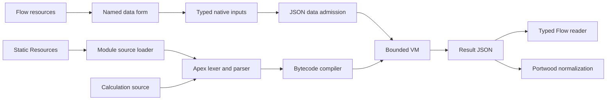

# Architecture

## Boundaries

The custom property editor persists real Flow value/reference metadata. It does not perform runtime resource-name lookup. Records are carried in top-level Aura-enabled input rows; multiple concrete record types can coexist. Primitive values use native typed channels, with inline Count mappings for collection sizes. Checked boundaries preserve group membership, including empty collections and null values. This avoids nested Apex conversion problems with dates and empty primitive collections.

`JsDirectInputs` validates names and shapes, copies each selected value to JSON data, and applies size/value/depth admission before VM import. `JsDataPolicy` centralizes naming and JSON admission. Input setup exposes none of the internal transport to admins.

`JsLibraryLoader` loads only configured Static Resources and builds separately scoped CommonJS modules. It does not resolve npm dependencies or perform library-specific substitutions. Its transaction cache contains source text, not mutable module instances. The combined source is compiled by `JsLexer`, `JsParser`, and `JsBytecodeCompiler`.

`JsBytecode` and `JsRuntime` execute against `JsValue`/`JsScope` with fresh per-request globals and prototypes. Native functions come from an explicit host table. Code can be reused for adjacent identical source within a bulk call; runtime state is isolated. `JsBudget` applies cooperative resource controls. Supported Promise work uses a bounded in-process job queue and is drained before serialization.

`JsResultAction` reads strict JSON paths and constructs typed values or flat records without DML. `JsPortwoodDataAction` reuses a calculation result when supplied, or prepares named data directly without running JavaScript. It wraps arrays as records loops and reports representative tags.

## Public surface

- `JsCollectionScriptAction.run`: Flow execution and metrics.
- `JsResultAction.run`: typed extraction.
- `JsPortwoodDataAction.run`: merge-data preparation.
- `JsInterpreter.execute`: convenience API for Apex callers with a JSON-object input.
- `JsLibraryController.listLibraries`: authoring-time choices only.

DTOs and runtime classes are implementation dependencies. Host-only flags and low-level bytecode internals are not supported release configuration. Test-only AST/bytecode harnesses are annotated `@IsTest` and expose no Flow actions.

The release contains no custom data objects, asynchronous jobs, scheduled automation, browser runtime, remote execution service, or managed Portwood dependency.
